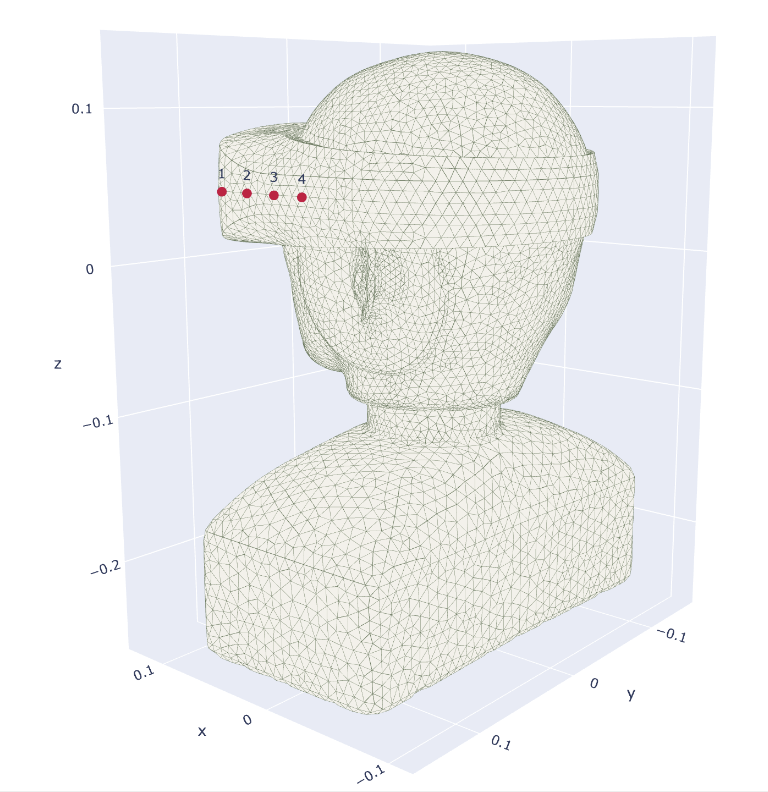
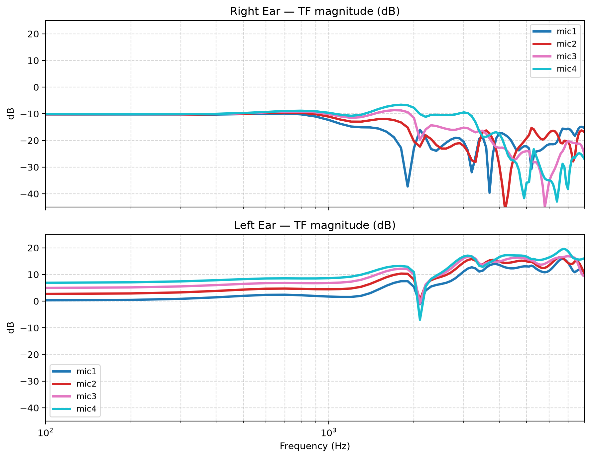
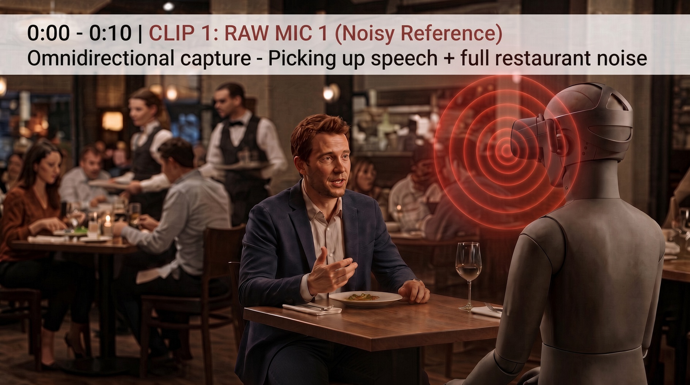
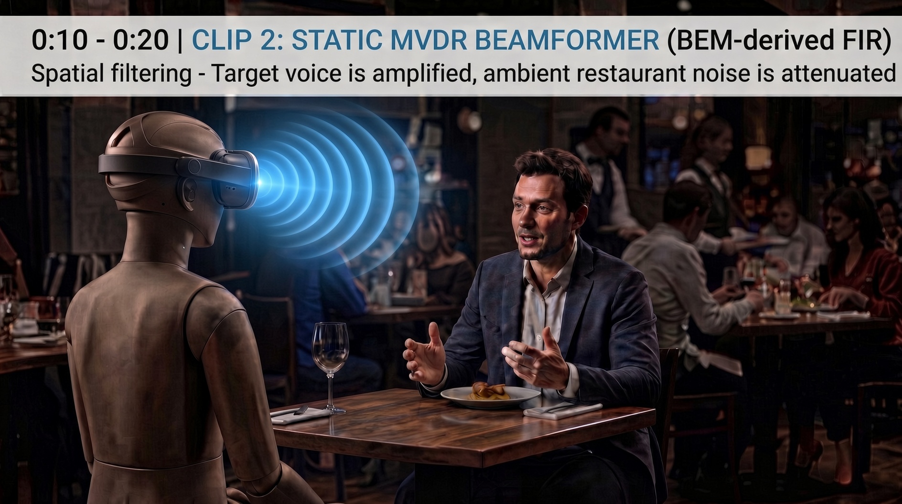
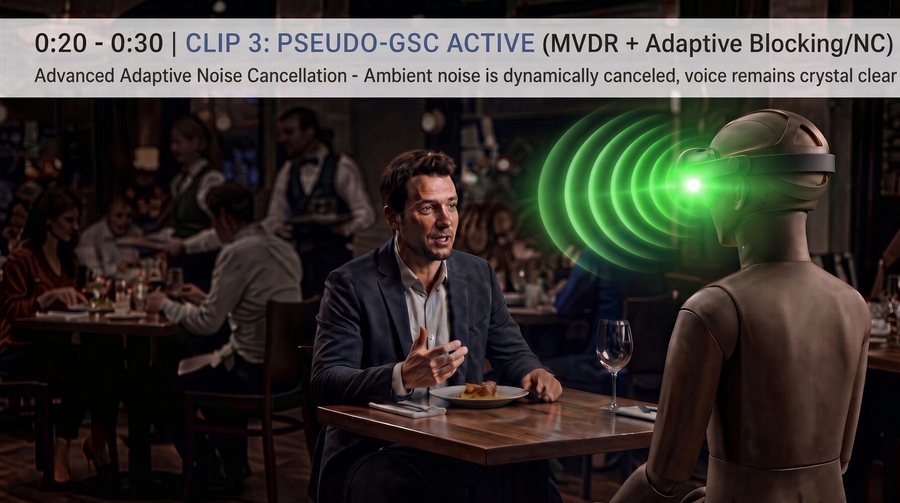

<h1>KEMAR + VR Headset    Multi-microphone Auralization Dataset</h1>

 

**Dr. Stéphane Dedieu**  
Applied Mathematics | Digital Signal Processing | ML  
November 2026  

 
 

**Under construction  26-11-2026**.... 

 
 
 

## Open Multi-Microphone Speech + Noise Mixtures for Wearable Research

Generated by projecting clean speech and binaural ambient recordings onto microphone arrays mounted on a KEMAR-style head with VR/AR headset geometry, **using Mesh2HRTF BEM transfer functions**.

Current release focuses on a far-field **4-microphone end-fire array**.  
Users can also select any subset of microphones according to their hardware layout (mics 1234 or mics 123 configurations).

---

## Overview

This dataset provides realistic multi-microphone mixtures for research on wearable audio (AR glasses / VR headsets).

- 4 microphone positions
- Clean speech projected from various directions and distances
- Ambient noise reconstructed from binaural recordings
- Different SNRs and source positions
- Users can freely choose a 3 microphone subset

The underlying acoustic model is the same KEMAR + headset mesh used in the companion repository.

---

### Strategy: Local, Open, Physics-Informed Multi-Microphone Noise Reduction

This repository develops a local, open-source alternative to cloud-based acoustic simulation and synthetic data platforms for multi-microphone speech enhancement on wearables (VR/AR headsets, smart glasses).

Instead of relying on proprietary cloud services, we generate realistic multi-microphone mixtures locally using:

- High-fidelity Boundary Element Method (BEM) transfer functions computed with **Mesh2HRTF** on a public KEMAR + VR/AR headset mesh
- Binaural ambient recordings projected onto the microphone array
- Clean speech rendered at controlled directions and distances

The resulting open datasets (speech + noise at multiple SNRs) are designed for research and development of:

- Classical spatial filtering (MVDR, LCMV)
- Pseudo-GSC architectures with orthogonal speech and noise channels
- Physics-Informed neural models that take advantage of the spatially orthogonalized channels

All data generation, beamforming, and model training remain under the control of the user.  
**No cloud dependency, no proprietary black-box simulation engine.**

<i>Figure 1:  Kemar+VR Headset - Boundary Element Model (BEM) - Microphone array 1234 on the left side .</i>

## Microphone layout 1234

Coordinates in metres (origin between the ears, +x forward, +y left, +z up).

| Mic | Side | x | y | z |
|-----|------|---|---|---|
| 1 | Left  | 0.1    |  0.097   |    0.04625 |
| 2 | Left  | 0.075  |  0.097   |    0.04625 |
| 3 | Left  | 0.05   |  0.097   |    0.04625 |
| 4 | Left  | 0.025  |  0.097   |    0.04625 |

Users can freely select any 3 microphones configuration.

---

## Ambient noise — Binaural recordings projected onto the microphones

###  Principle 

On the BEM mesh of the KEMAR + VR headset, the boundary elements corresponding to the eardrums of both ears were used. A velocity boundary condition was applied on these elements and normalized by the eardrum surface area.Transfer functions were then computed from the left ear and the right ear to microphones 1, 2, 3 and 4.

These transfer functions allow a binaural ambient recording to be projected onto the four microphones of the array. Once the ambient noise has been auralized on the array, clean speech can be added and mixed at the desired SNR.

###  Transfer functions - Left ear, Right ear to array microphones 1,2,3,4

The figure below shows the magnitude of the transfer functions between the right ear, the left ear, and the four microphones of the array.Given the proximity of the microphones, the left ear is dominant, and therefore so is the left channel of the binaural recording.
Above 1 kHz, the head-shadow effect strongly attenuates the contribution of the right ear (and thus the right channel of any binaural recording).

<i>Figure 3: Transfer functions Left Ear and Rght Ear to microphones 1234 .</i>

###  Binaural recordings 

Realistic ambient noise is obtained by taking free binaural street/restaurant recordings and projecting them onto the 4 microphone positions of the KEMAR + VR headset model using the Mesh2HRTF BEM transfer functions.

Four free binaural recordings have been selected:

- [Hong Kong busy street (binaural)](https://freesound.org/people/kevp888/sounds/465660/)  
  Traffic, pedestrians, and typical city noise. Recorded with Ohrwurm 3D binaural microphones.

- [Hong Kong street (binaural)](https://freesound.org/people/kevp888/sounds/465659/)  
  Slightly quieter version of the same street scene.

- [Westside Highway, New York (binaural)](https://freesound.org/people/overmedium/sounds/652764/)  
  Immersive walk along a New York parkway. Good spatial contrast between traffic and open space.

- [Residential road traffic (binaural)](https://freesound.org/people/KVV_Audio/sounds/784795/)  
  Suburban traffic with distant city hum. Recorded with a Zoom H3-VR.

- [Recording of a small restaurant. (binaural)](https://freesound.org/people/moxobna/sounds/28204/)  
  People eating and chatting. Close to classic cocktail-party noise.(Microphone model not specified) 

These recordings are auralized onto the 4-microphone array. Users can then select any 3 microphones according to their own hardware configuration.

---

### Data Augmentation

Binaural ambient noise recordings are projected onto the microphone array.  
The acoustic scene can be rotated in discrete angular steps (e.g. 15° or 30°) to generate additional training examples while preserving the physical transfer functions.

This approach multiplies the amount of realistic multi-channel data available for training beamforming or neural enhancement models without requiring new BEM computations.

The data augmentation approach for rotating the 3D field is currently under development. It will not be based on Ambisonics or any other standard spatial audio method, but on a custom technology.

---

##  Auralization and Beamforming Illustration

The video shows a 30-second restaurant scene with progressive noise reduction on a 4-microphone end-fire array mounted on a KEMAR-style head + VR headset.

**0:00 – 0:10 | Raw microphone 1**
Only microphone 1 is active. Omnidirectional capture: speech + full restaurant noise (cocktail-party type).

**0:10 – 0:20 | Static MVDR beamformer**
A fixed MVDR beamformer is applied.
MVDR is a spatial noise reduction method: it amplifies the target voice while attenuating ambient noise coming from other directions, using the BEM-derived transfer functions.

**0:20 – 0:30 | Pseudo-GSC**
A pseudo-GSC is activated.
In addition to the spatial reduction already performed by the MVDR, an adaptive noise canceller operates in the time domain (or frequency domain). The residual noise is further reduced while the target voice remains clear.

The array geometry and steering vectors come from the open Mesh2HRTF simulation published in the companion repository.

**Important Note**: Reciprocity principle

In acoustics, reciprocity states that the transfer function between a source and a receiver is identical if the roles are reversed.By reciprocity, a single omnidirectional microphone can be seen as an omnidirectional sound source.
A beamformer (such as the MVDR) can be seen as a directional emitter whose gain is increased in the look direction. The wavefronts remain the same; only the directional gain changes.

This is why the illustrations below show:
**Clip 1**: a single microphone as an omnidirectional source  
**Clip 2**: the MVDR beamformer as a directional source with higher gain toward the talker   
**Clip 3**: the pseudo-GSC preserves the directional pattern of the MVDR source and adds a non-spatial noise-reduction gain in the time or frequency domain.

 

|

 |

 |

|
|:------:|:------:|:------:|
|
  <i> Single omnidirectional microphone    Microphone 1 </i>  
| 
  <i> MVDR Beamforming    Look direction = 0 deg </i>  
|
  <i> Pseudo-GSC beamforming   Look direction = 0 deg, Wiener gain. </i>  
|

</ul></ul>

## Generalized Sidelobe Canceller

In this linear end-fire configuration, a Generalized Sidelobe Canceller (GSC) can be implemented to cancel noise coming mainly from the rear (and other non-look directions).The GSC produces two channels (speech and noise) that are made as orthogonal as possible. The noise channel is then subtracted from the speech channel with an appropriate gain.

While a planar array (e.g. 3+3) would offer more flexibility for ambient noise cancellation from multiple directions, the end-fire layout remains effective for suppressing noise from behind the array, which is a common case in wearable devices.

Within the design of the GSC, we create multi-microphone mixtures. We will show a reconstruction example on a speech + background noise mixture.

## Workflow

1. You provide your microphone array configuration (positions, headset/glasses geometry).
2. Corresponding BEM transfer functions (Mesh2HRTF) and multi-microphone mixtures are generated (speech + realistic ambient noise projected from binaural recordings).
3. You can validate the simulations against your own measurements if desired.
4. You receive ready-to-use multi-channel datasets (multiple SNRs, source directions, rotated scenes) to train your models.

**Target applications:** VR/AR headsets, smart glasses, and other wearable microphone arrays.  
Everything is transparent, reproducible, and under your control.

---

## Contents

- `mixtures/` — 4-channel speech + noise mixtures
- `metadata/` — Microphone coordinates, source positions, SNR, noise type
- `README.md` — This file

License: MIT

---

## How to use

1. Download the mixtures.
2. Choose the microphone subset that matches your AR glasses.
3. Apply your beamformer or 2-channel noise reduction.

## Acknowledgements

Mesh2HRTF / NumCalc team (ARI Vienna, TU Berlin).  
Companion repository (mesh + transfer functions):  
[KEMAR-VR_Headset_Acoustic_Beamforming_with_Mesh2HRTF](https://github.com/DrStef/KEMAR-VR_Headset_Acoustic_Beamforming_with_Mesh2HRTF)

Company page: [bloo-audio.com](https://www.bloo-audio.com)
